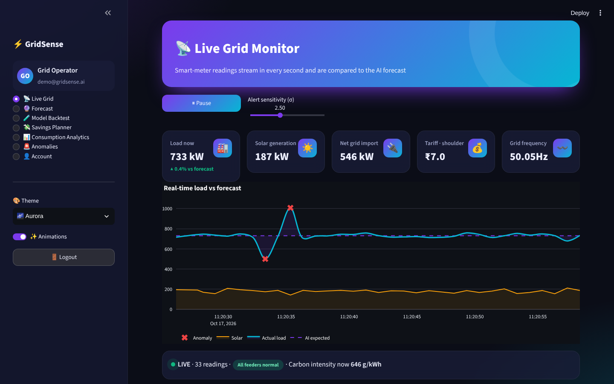
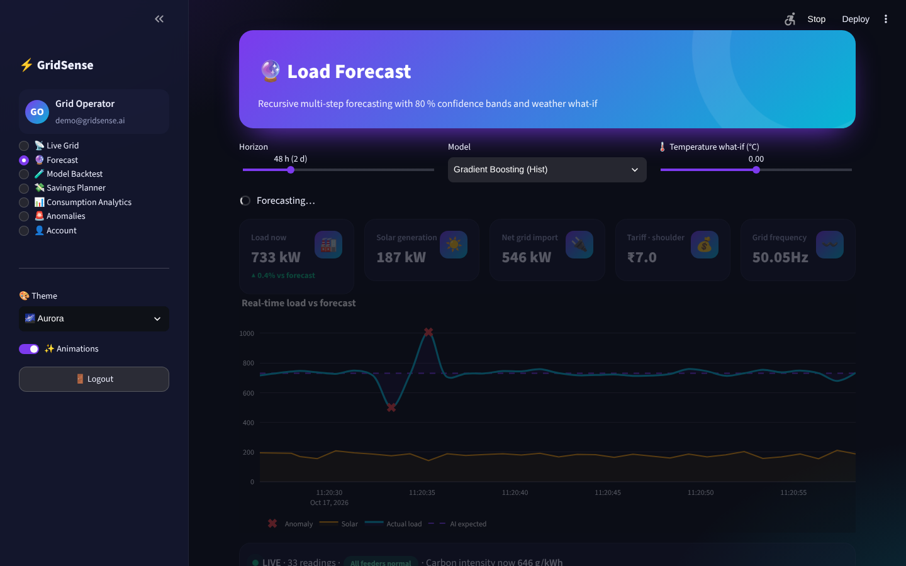
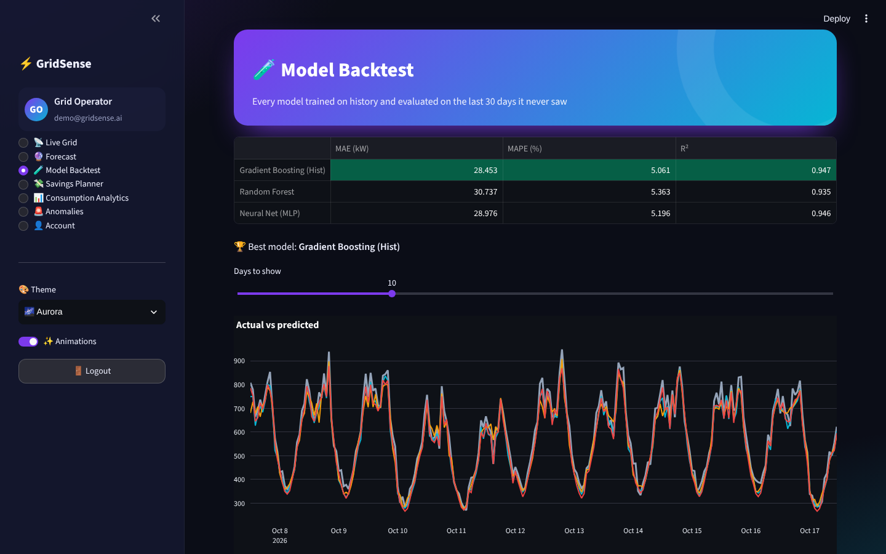
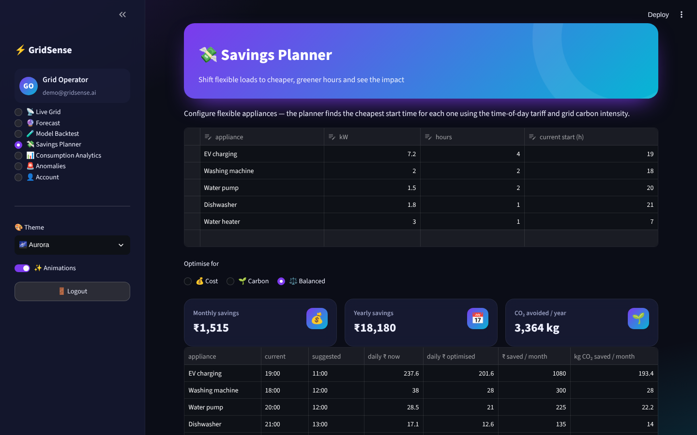
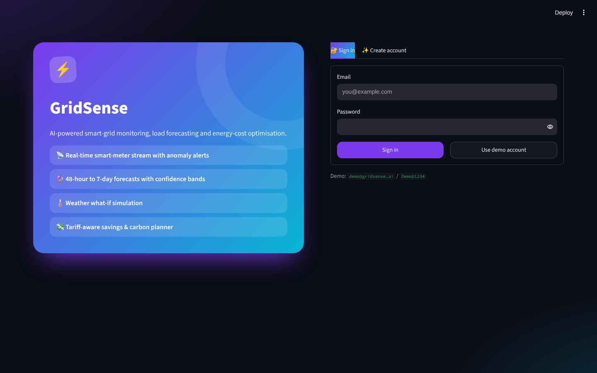
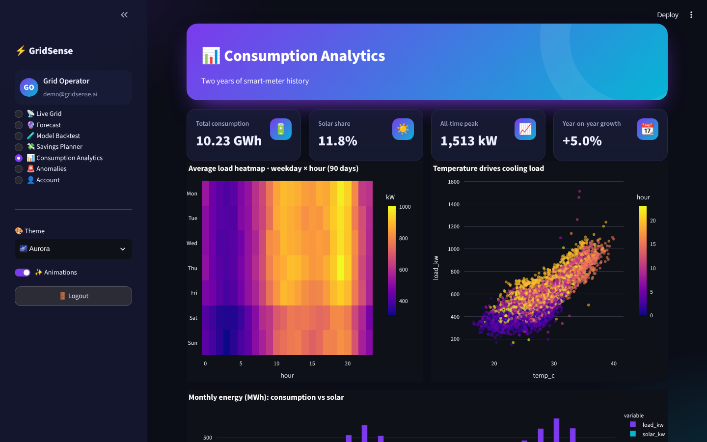
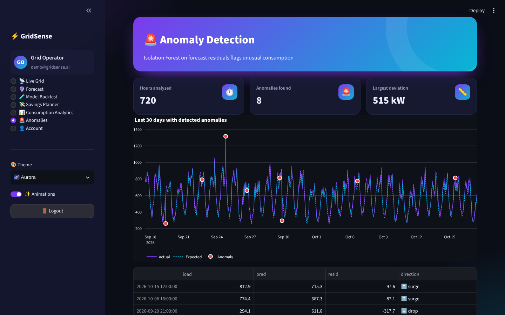

<div align="center">

# ⚡ GridSense

### AI-powered smart-grid monitoring, energy load forecasting & cost/carbon optimisation


</div>



## ✨ Features

| Module | Highlights |
|---|---|
| 🔐 **Register / Login** | SQLite users, salted **PBKDF2-SHA256** hashing, strength meter, validation, demo account, activity log, change password |
| 📡 **Live Grid** | Smart-meter readings stream every second (auto-refreshing fragment): load, solar, net import, live tariff, grid frequency, carbon intensity; real-time chart vs the AI-expected profile with **σ-based anomaly alerts**, pause/resume |
| 🔮 **Forecast** | 24 h – 7 day **recursive multi-step forecasts** with 80 % quantile confidence bands, model selector, **temperature what-if** (±5 °C), energy / peak / cost KPIs, CSV export |
| 🧪 **Model Backtest** | Hist Gradient Boosting vs Random Forest vs Neural Net (MLP) on 30 unseen days — MAE, MAPE, R², actual-vs-predicted overlay, residuals, permutation importance |
| 💸 **Savings Planner** | Editable appliance table (EV, pump, washer…) → optimal start times for **cost, carbon or both**, monthly/yearly ₹ savings and CO₂ avoided, tariff & carbon curves |
| 📊 **Consumption Analytics** | Weekday × hour heatmap, temperature-vs-load scatter, monthly consumption vs solar, YoY growth |
| 🚨 **Anomalies** | Isolation Forest on forecast residuals — surges and drops highlighted on the timeline and listed |
| 🎨 **Themes & animations** | 5 colour themes, glassmorphism cards, animated hero, pulsing live badge, page transitions, animation toggle |

## 🧠 How it works

* **Data** – two years of hourly smart-grid data generated with daily/weekly seasonality, temperature-driven cooling load, holidays, growth trend, solar generation with cloud cover and injected faults (no download needed).
* **Features** – calendar (hour, weekday, month, holiday, cyclical hour), weather (temperature & cooling-degree²) and autoregressive lags (24 h, 48 h, 168 h, 24 h rolling mean).
* **Models** – HistGradientBoosting, Random Forest and an MLP neural network; quantile Gradient Boosting (10th/90th percentile) for uncertainty bands.
* **Forecasting** – recursive: each predicted hour is fed back as a lag for the next one.

## 🖼️ Screenshots

| Forecast | Backtest | Savings planner |
|---|---|---|
|  |  |  |

| Login | Analytics | Anomalies |
|---|---|---|
|  |  |  |

## 🚀 Run locally

```bash
git clone https://github.com/PreciousBharath/GRIDSENSE-ENERGY-LOAD-FORECASTING.git
cd GRIDSENSE-ENERGY-LOAD-FORECASTING
pip install -r requirements.txt
streamlit run app.py
```

Click **Use demo account** (`demo@gridsense.ai` / `Demo@1234`) or create an account. Models train once on first launch (~20 s) and are cached.

## 🧱 Project structure

```
├── app.py              # Streamlit pages
├── core/
│   ├── engine.py       # data generator, features, models, forecasting, anomalies, tariff & carbon
│   ├── auth.py         # SQLite users, PBKDF2 hashing, login/register UI
│   └── ui.py           # themes, animations, KPI cards, Plotly template
├── .streamlit/config.toml
└── requirements.txt
```

## 📄 License

MIT © [Bharath](https://github.com/PreciousBharath)
